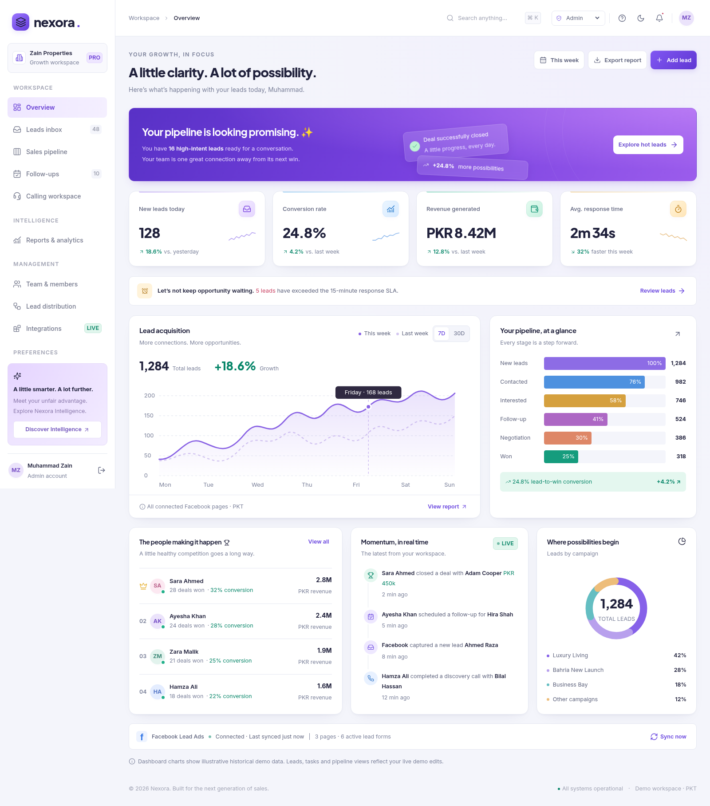
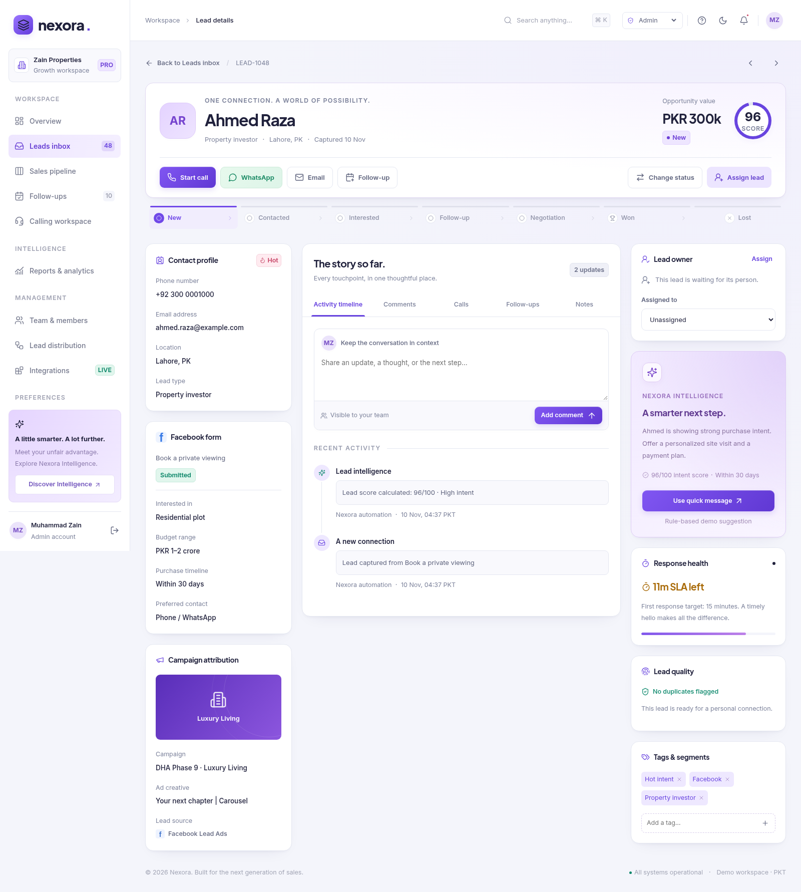

# Nexora — Facebook Leads CRM

A premium, front-end-only CRM prototype built with **HTML, CSS, and vanilla JavaScript**. No backend, build step, account, or server is required.

## Start here

1. Clone this repository, or download and unzip it.
2. **Double-click `index.html`.** No web server, install, or build step is required. Keep `assets/` beside it.
3. Choose **Admin**, **Manager**, or **Agent** from the role dropdown. Leave the prefilled synthetic email/password in place and click **Sign in**. No real credentials are needed.
4. Change roles anytime using the top-bar switcher.

**Roman Urdu:** ZIP extract karein, `index.html` double-click karke kholein. Dropdown se Admin, Manager ya Agent select karein aur prefilled test email/password ke saath Sign in dabayein. Asli password enter na karein. Server, npm ya installation ki zaroorat nahi.

Everything required is bundled locally, including fonts and icons. The UI works offline. Chrome/Edge are recommended; a current Firefox or Safari should also work. JavaScript must be enabled.

## Screenshots

Open `index.html` in the browser and sign in. These previews are stored in `screenshots/`.





## A client-ready workspace

- **Styled sign-in:** role dropdown, email/password fields, password visibility toggle, local validation, editorial split-screen layout and glass-style opportunity preview.
- **Dashboard:** acquisition trend, conversion, revenue, response time, SLA alert, sales funnel, campaign mix, gamified leaderboard, activity, Facebook sync status.
- **Leads inbox:** 48 synthetic Pakistani/international leads; search; campaign, agent, status and date filters; pagination; page sizing; bulk selection, assignment and status updates; unassigned, high-intent and duplicate queues; table/board toggle.
- **Sales pipeline:** seven stages, draggable cards, live deal counts and PKR totals. Use the lead page’s stage progress bar or status selector as a touch/keyboard alternative to dragging. Columns scroll independently; the board scrolls sideways.
- **Dedicated lead page (`#/lead/<id>`):** bookmarkable full-page workspace with back/breadcrumb navigation, stage progress bar and quick actions; left contact/FB form/campaign column; center Activity timeline, Comments, Calls, Follow-ups and Notes tabs; right owner, suggested next action, SLA, duplicate quality and editable tags. No side drawer.
- **Conversations:** simulated call timer, mute/speaker controls, dispositions, duration, notes, call history, WhatsApp template selection/edit/copy. Nothing dials, records, or sends.
- **Follow-ups:** Today/Overdue/Upcoming/Completed, completion/reopening, monthly calendar, date selection, new tasks, priorities.
- **Agent workspace:** only assigned leads, personal dashboard and performance, next-best-lead queue, daily targets, call queue and quick scripts.
- **Team:** add/edit local users, roles, teams and active/away state; workload cards and assigned lead links.
- **Distribution:** round-robin participant selection, campaign/team mapping, least-workload routing, capacity limits and skipping unavailable agents. Run on unassigned leads manually.
- **Reports:** agent performance, campaign ROI, call analytics and real CSV downloads.
- **Integrations:** simulated Facebook pages/forms, WhatsApp, Sheets, webhook delivery monitor and local connect/disconnect controls.
- **Finishing touches:** global search with Ctrl/⌘+K, keyboard navigation, notifications/read state, responsive mobile sidebar, light/dark mode, editable profile/workspace preferences, restrained animations, accessible focus states and toast feedback.

## Role behavior

| Role    | Demo access                                                                                                        |
| ------- | ------------------------------------------------------------------------------------------------------------------ |
| Admin   | All leads, assignment, team administration, rules, integrations, reports                                           |
| Manager | All leads, assignment, rules, integrations, reports; no team administration                                        |
| Agent   | Ayesha Khan’s assigned leads, tasks, calling queue and own performance; no assignment controls or management menus |

This is **UI role simulation, not authentication or a security boundary**. JavaScript data remains inspectable. Production authorization belongs on a backend.

## Files

```
index.html                    Start here
assets/favicon.svg            Nexora app mark
assets/css/fonts.css          Bundled font definitions
assets/css/styles.css         Shared component styles
assets/css/refresh.css        Revised typography, premium colors, full-page layout
assets/js/data.js             Synthetic leads, agents, campaigns, tasks
assets/js/app.js              Router, views, state and interactions
assets/fonts/*.ttf            Local Inter + Plus Jakarta Sans fonts
assets/vendor/lucide.min.js   Local icon library
assets/licenses/              Font and icon licenses
screenshots/                  Clean desktop and mobile previews
tests/smoke.cjs                Optional browser QA (82 assertions)
tests/extended.cjs             Optional additional browser QA
tests/report.json             Most recent smoke-test results
tests/revision.cjs             Sign-in, lead routes and responsive/type QA
tests/revision-report.json     Revision assertions + typography audits
tests/screenshots.cjs          Regenerate clean desktop/mobile previews
CHANGELOG.md                  Second-edition update notes
DEMO-GUIDE.md                  A short client walkthrough
QA.md                         Verification and known limitations
```

## Demo data & state

- All contacts, numbers, campaigns and commercial figures are **synthetic**. Use only test details when adding records.
- Lead/task/team/routing edits live **in memory**. Refreshing the browser resets the demo. The theme preference is saved locally when browser storage is available.
- Dates and timestamps display in **Asia/Karachi / PKT (UTC+05:00)**. Follow-up input is interpreted as PKT, independent of the viewer’s computer timezone.
- Lead lists, pipeline totals, assignments, notes, tasks and call logs update immediately from the current in-memory data.
- Historical dashboard/ROI charts and gamified rankings are illustrative snapshots, not recalculated analytics. Their labels say so. The dashboard chart supports 7D/30D; report range controls explain the static sample period.
- CSV exports are generated locally from current demo lead or agent data. Spreadsheet-formula-like values are escaped.

## Customize

- **Brand/colors/type scale:** edit the revised CSS variables at the top of `assets/css/refresh.css` and the brand markup in `app.js`.
- **Mock campaigns, agents and records:** `assets/js/data.js`.
- **Pages:** `renderDashboard`, `renderLeads`, etc. in `app.js`.
- **Interactions:** delegated click/change/input/submit handlers near the end of `app.js`.
- **Currency:** the `money` helper; all original values are PKR.
- **New pages:** extend `routeNames`, `navGroups`, and the view map in `render`.

No ES-module imports or local JSON fetching are used, intentionally, so the app works over `file://`.

## Optional developer QA

The app needs **no npm dependencies**. Only the optional QA scripts use Puppeteer:

```
npm install --no-save puppeteer-core
CHROME_PATH=/path/to/chrome node tests/smoke.cjs
CHROME_PATH=/path/to/chrome node tests/extended.cjs
CHROME_PATH=/path/to/chrome node tests/revision.cjs
CHROME_PATH=/path/to/chrome node tests/screenshots.cjs
```

Run those commands only if you want to rerun automated browser tests. Set `CHROME_PATH` to your Chrome executable. Tests never contact external services.

## Not included

No production authentication, database, real Meta lead ingestion, OAuth, calling/telephony, WhatsApp messaging, real AI, background reminders, persistent user management, payments or backend integration. Those are deliberately outside this UI-only prototype.
